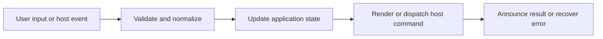

# Theme Modes, Styles, Pet Themes, and Custom Remix

## Feature intent

Define valid appearance values, CSS token application, style grouping, custom theme model, validation ranges, migration, and background handling.

## Capability contract

| Capability | Required behavior | User result |
|---|---|---|
| Mode | Auto, light, or dark. | Theme follows system or explicit choice. |
| Built-in style | Default, bento, vercel, Tokyo Night, neon voltage, raw grid, and pet styles. | Curated visual systems. |
| Custom remix | Override colors/layout/background from a valid base style. | Personal theme without arbitrary CSS. |
| Migration | Map retired values to supported equivalents. | Upgrades remain readable. |
| Validation | Clamp ranges and validate image data URL/MIME/size. | Theme data stays safe/bounded. |

## Interaction and processing flow



### Active styles

`default`, `bento`, `vercel`, `tokyo-night`, `neon-voltage`, `cyberpunk`, `raw-grid`, `pet-white-shiba`, `pet-k-ink`, `pet-cat`, `pet-hamster`, `pet-corgi`.

`glass` stylesheets/tests do not make `glass` a valid current `ThemeStyle`. Unknown values normalize to `default`. Legacy `pet-shiba-memes` maps to `tokyo-night`; `night-city-2077` maps to `cyberpunk`; `pet-shiba` maps to `pet-white-shiba`.

### Pet Theme Rail Markers

Pet theme indicator markers use species-tailored SVG assets in `ui/src/assets/themes/pets/rail-markers/`:
- `cat-paw.svg` (Cat paw with retractable claw vector elements and `aria-label="Cat paw"`)
- `corgi-paw.svg` (`aria-label="Corgi paw"`)
- `hamster-paw.svg` (`aria-label="Hamster paw"`)
- `k-ink-paw.svg` (`aria-label="K-Ink wolf paw"` with shorter claw tip path)
- `white-shiba-paw.svg` (`aria-label="White shiba paw"`)

### Default (Raw Grid) Theme specific layout

- **Background Grid**: Grid background size set to `48px 48px`.
- **Content Padding**: Outer `.content__scroll` padding set to `12px 16px 20px`; inner `.mdn-body` padding set to `20px 24px`.
- **State Screen Panels**: Empty/state screens (`.state-screen:not(.state-screen--loading)`, such as `No supported documents found`) render inside a solid panel with background `var(--bg)`, border `var(--stroke-w) solid var(--bd-s)`, `max-width: 600px`, `height: fit-content`, `padding: 24px 28px`, and centered vertically and horizontally in `.content__scroll` via flex column layout and `margin: auto` (matching `.welcome-container` presentation).

### Theme-Adaptive Badge, Pill, and Control Geometry Rule

All badges, tags, count pills, step indicators, keycaps, and action buttons (including `.welcome-tour-trigger-btn__badge`, `.tour-guide-badge`, `.tour-guide-dot`, `.hero-star-banner__count`, `.welcome-ecosystem__count`, `.welcome-ecosystem__item-tag`, `.tip-card-badge`, `.file-history__badge`, `.repository-history__head-badge`, `.desktop-font-card__badge`, and `.tree-file-search-count-badge`) MUST use theme border-radius tokens (`var(--r-sm, var(--r))` for badges/tags/indicators/keycaps; `var(--r-md, var(--r))` for buttons) and theme geometry rather than hardcoded pill radii (`999px`, `12px`, `20px`). Specifically:
- `raw-grid` (Default): `--r-sm: 0px; --r: 0px; --r-md: 0px; --r-lg: 0px;` (sharp `0px` rectangular corners).
- `cyberpunk`: `--r-sm: 0px;` with 6-sided closed-border 45° cut-corner `clip-path` polygon geometry.
- Rounded built-in & pet styles (`default`, `bento`, `vercel`, `tokyo-night`, `neon-voltage`, `pet-*`): follow `--r-sm` (`4px`–`6px`) and `--r-md` (`6px`–`10px`).

### Unified Custom Tooltip Rule (No Native `title` Tooltips on UI Elements)

- All UI hover hints must use either `data-hover-tooltip="..."` (rendered via `HoverTooltipPortal`) or `<Tooltip>` / `.tooltip-container` + `.tooltip-text`.
- Native HTML `title=` attributes must NEVER be placed on buttons, links, badges, tabs, or text labels (neither standalone nor alongside `data-hover-tooltip` / `<Tooltip>`), preventing native OS browser tooltips from clashing with or double-rendering over theme-styled custom tooltips.
- Exception: `<iframe>` elements retain `title="..."` strictly as a WCAG accessible frame name.

### Custom limits

- Maximum 24 custom themes.
- ID ≤64 chars; name ≤48 chars.
- Background Data URL ≤900,000 chars; png/jpeg/webp/gif only.
- Radius 0–18; stroke 0–3; content padding 16–64; section gap 4–28.
- Background opacity 0–0.5; blur 0–18; position ≤48 chars.


## States and failure behavior

| State | Required presentation | Exit condition |
|---|---|---|
| Built-in | Mode/style active | Choose/remix |
| Editing remix | Validated draft preview | Save/cancel |
| Custom active | Custom ID + normalized theme | Edit/delete/fallback |
| Invalid persisted | Fallback default | Select valid theme |

## Runtime behavior

| Runtime | Specification |
|---|---|
| All | Shared token/style implementation. |
| Auto mode | Uses host/system color preference. |
| Background image | Local Data URL only; no arbitrary remote CSS. |

## Non-functional requirements

- All actions remain keyboard reachable.
- A failed enhancement must not prevent the base document from rendering.
- Host-facing inputs are validated before filesystem, shell, or network access.


## Acceptance criteria

- [ ] All badges, tags, count pills, and tour indicators inherit active theme border-radius tokens and shape geometry.
- [ ] Only active style union values persist.
- [ ] All custom numeric fields stay in range.
- [ ] Oversized/unsupported background images are rejected.
- [ ] Legacy theme values migrate deterministically.
## UI reference implementation

The sample shows the interaction boundary, not a replacement for the React implementation.

```html
<section class="spec-theme-modes-styles-pet-themes-and-custom-remix" aria-labelledby="theme-modes-styles-pet-themes-and-custom-remix-title">
  <h2 id="theme-modes-styles-pet-themes-and-custom-remix-title">Theme Modes, Styles, Pet Themes, and Custom Remix</h2>
  <p data-status role="status" aria-live="polite">Ready</p>
  <button type="button" data-action>Apply appearance</button>
</section>
```

```css
.spec-theme-modes-styles-pet-themes-and-custom-remix {
  display: grid;
  gap: 0.75rem;
  padding: 1rem;
  border: 1px solid var(--border);
  border-radius: var(--radius, 8px);
  background: var(--surface);
  color: var(--text);
}
.spec-theme-modes-styles-pet-themes-and-custom-remix button:focus-visible {
  outline: 2px solid var(--accent);
  outline-offset: 2px;
}
```

```javascript
const root = document.querySelector('.spec-theme-modes-styles-pet-themes-and-custom-remix');
const status = root.querySelector('[data-status]');
root.querySelector('[data-action]').addEventListener('click', () => {
  window.PlatformBridge.postMessage({ command: 'updateAppearance', theme: 'dark', themeStyle: 'tokyo-night' });
  status.textContent = 'Request sent';
});
```
## Source traceability

| Kind | Path | Purpose |
|---|---|---|
| Implementation | `ui/src/themeTypes.ts` | Active behavior or contract |
| Implementation | `ui/src/theme/customThemes.ts` | Active behavior or contract |
| Implementation | `ui/src/components/Settings/ThemeStylePicker.tsx` | Active behavior or contract |
| Implementation | `ui/src/components/Settings/ThemeRemixModal.tsx` | Active behavior or contract |
| Implementation | `ui/src/styles/tokens.css` | Active behavior or contract |
| Verification | `tests/node/theme-grouping-and-styles.test.mjs` | Automated expectation |
| Verification | `tests/unit/ui/custom-themes.test.ts` | Automated expectation |
| Verification | `tests/unit/ui/components/theme-remix-interactions.test.tsx` | Automated expectation |

---

[← Settings, Preferences, and Import/Export](12-settings-preferences-import-export.md) · [Documentation index](../README.md) · [Keyboard, Accessibility, Focus, and Responsive Behavior →](14-keyboard-accessibility-responsive.md)


## Localization

Theme Remix presentation strings—including modal controls, dropdown labels, color names, background-image validation, create/duplicate/delete/apply feedback, and accessibility labels—resolve through the `themeRemix` translation domain in all nine supported locales. Internal theme IDs and CSS variable names remain stable technical values.
